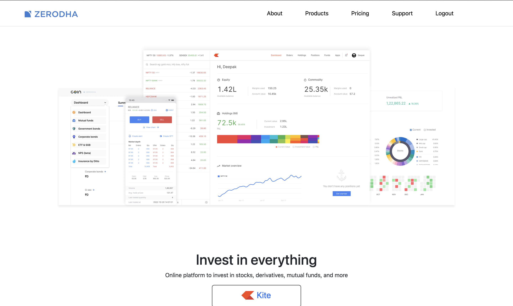
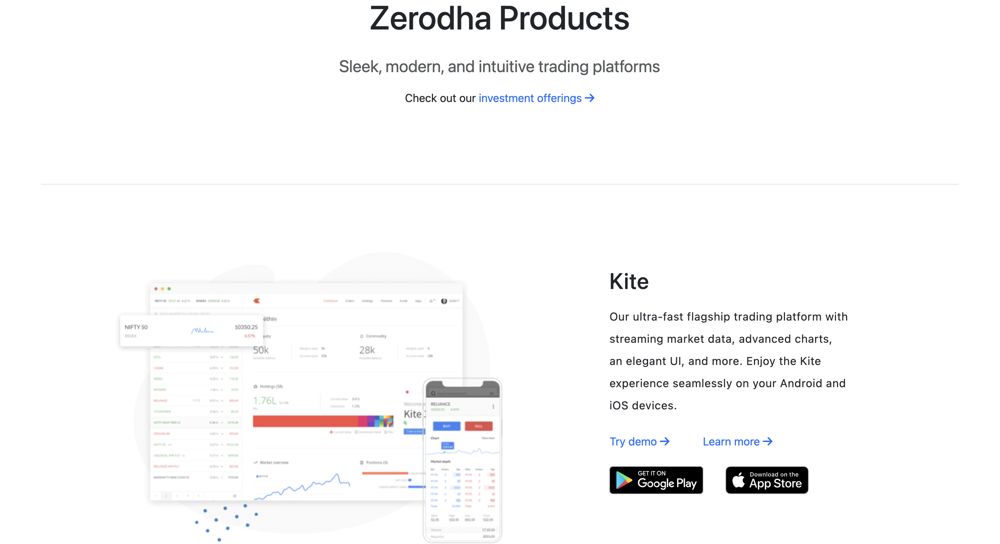
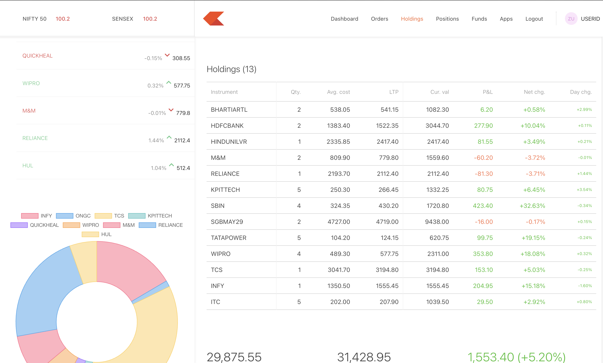
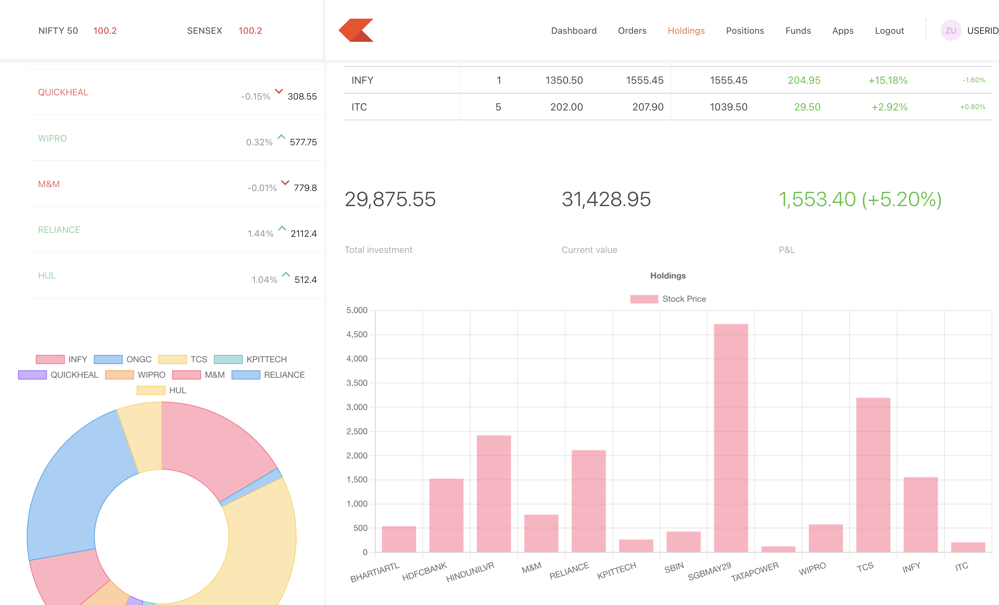

# TradeNest 📈

> A full-stack trading platform simulation inspired by Zerodha
TradeNest is a comprehensive trading platform web application that simulates real-world stock trading experiences. Built with modern web technologies, it features a responsive landing page, an interactive trading dashboard, and a robust backend API.




## 🚀 Features

### 🏠 Landing Platform
- **Modern Homepage** - Engaging introduction to the platform
- **Product Showcase** - Detailed trading tools and features
- **Transparent Pricing** - Clear fee structure and plans
- **Support Center** - Help documentation and ticket system
- **About Section** - Company information and team details

### 📊 Trading Dashboard
- **Live Watchlist** - Track your favorite stocks in real-time
- **Portfolio Management** - Comprehensive view of your investments
- **Holdings Tracker** - Detailed breakdown of owned securities
- **Position Monitoring** - Real-time tracking of active trades
- **Order Management** - Place, modify, and track orders
- **Fund Management** - Account balance and transaction history

### 🔐 Authentication System
- **Traditional Auth** - Email/password registration and login
- **Google OAuth** - Seamless Google account integration
- **JWT Security** - Secure token-based authentication
- **Session Management** - Persistent login sessions





## 🛠️ Tech Stack

### Frontend & Dashboard
| Technology | Purpose |
|------------|---------|
| **React 18** | UI framework with hooks |
| **Vite** | Fast development build tool |
| **Material-UI** | Modern component library |
| **Bootstrap** | Responsive CSS framework |
| **Chart.js** | Interactive data visualization |
| **React Router** | Client-side routing |
| **React Query** | Data fetching and caching |
| **Axios** | HTTP client for API calls |

### Backend
| Technology | Purpose |
|------------|---------|
| **Node.js** | Server runtime environment |
| **Express.js** | Web application framework |
| **MongoDB** | NoSQL database |
| **Mongoose** | MongoDB object modeling |
| **JWT** | Authentication tokens |
| **bcrypt** | Password hashing |
| **CORS** | Cross-origin resource sharing |

### Authentication & Security
| Service | Purpose |
|---------|---------|
| **Firebase Auth** | Google OAuth integration |
| **JWT Tokens** | Secure API authentication |
| **bcrypt** | Password encryption |

## 📁 Project Structure

```
TradeNest/
├── 📂 frontend/                 # Landing page & authentication
│   ├── 📂 src/
│   │   ├── 📂 landing_page/
│   │   │   ├── 📂 home/         # Homepage components
│   │   │   ├── 📂 about/        # About page
│   │   │   ├── 📂 products/     # Product showcase
│   │   │   ├── 📂 pricing/      # Pricing plans
│   │   │   ├── 📂 support/      # Support center
│   │   │   └── 📂 signup/       # Authentication
│   │   └── 📂 utils/            # Firebase & auth utilities
│   └── 📂 public/               # Static assets
│
├── 📂 dashboard/                # Trading interface
│   ├── 📂 src/
│   │   ├── 📂 components/       # React components
│   │   │   ├── Dashboard.jsx    # Main dashboard
│   │   │   ├── Holdings.jsx     # Portfolio holdings
│   │   │   ├── Positions.jsx    # Trading positions
│   │   │   ├── Orders.jsx       # Order management
│   │   │   ├── WatchList.jsx    # Stock watchlist
│   │   │   └── Funds.jsx        # Fund management
│   │   └── 📂 data/             # Mock data
│   └── 📂 public/               # Dashboard assets
│
└── 📂 backend/                  # API server
    ├── 📂 Controllers/          # Request handlers
    ├── 📂 Models/               # Database models
    ├── 📂 Routes/               # API routes
    ├── 📂 Middlewares/          # Custom middleware
    ├── 📂 schemas/              # Data validation schemas
    └── 📂 Utils/                # Helper functions
```

## ⚡ Quick Start

### Prerequisites
Make sure you have the following installed:
- **Node.js** (v18 or higher)
- **npm** or **yarn**
- **MongoDB** (local or cloud instance)
- **Git**

### 🔧 Installation

1. **Clone the repository**
   ```bash
   git clone https://github.com/yourusername/TradeNest.git
   cd TradeNest
   ```

2. **Setup Backend**
   ```bash
   cd backend
   npm install
   
   # Create environment file
   cp .env.example .env
   # Edit .env with your configuration:
   # MONGO_URL=your_mongodb_connection_string
   # TOKEN_KEY=your_jwt_secret_key
   # PORT=3002
   
   npm run dev
   ```

3. **Setup Frontend**
   ```bash
   cd frontend
   npm install
   npm run dev
   # Runs on http://localhost:3000
   ```

4. **Setup Dashboard**
   ```bash
   cd dashboard
   npm install
   npm run dev
   # Runs on http://localhost:3001
   ```

### 🎯 Usage

1. **Access the Landing Page** → `http://localhost:3000`
2. **Create an Account** → Sign up with email or Google
3. **Access Trading Dashboard** → `http://localhost:3001`
4. **Start Trading** → Add stocks to watchlist, view portfolio, place orders


## 🌐 API Documentation

### Authentication Endpoints
| Method | Endpoint | Description | Body |
|--------|----------|-------------|------|
| `POST` | `/signup` | Register new user | `{email, password, name}` |
| `POST` | `/login` | User authentication | `{email, password}` |
| `POST` | `/verify` | Verify JWT token | `{token}` |

### Trading Endpoints
| Method | Endpoint | Description | Auth Required |
|--------|----------|-------------|---------------|
| `GET` | `/allHoldings` | Get user holdings | ✅ |
| `GET` | `/allPositions` | Get user positions | ✅ |
| `POST` | `/newOrder` | Place new order | ✅ |

### Example API Response
```json
{
  "success": true,
  "data": {
    "holdings": [
      {
        "name": "RELIANCE",
        "qty": 10,
        "avg": 2450.50,
        "price": 2480.75,
        "net": "+1.24%",
        "day": "+0.85%"
      }
    ]
  }
}
```

## 🎨 Screenshots

### Landing Page


### Trading Dashboard


### Portfolio Management


## 🚀 Deployment

### Frontend Deployment (Vercel)
```bash
cd frontend
npm run build
# Deploy to Vercel
```

### Backend Deployment (Railway/Heroku)
```bash
cd backend
# Add production environment variables
# Deploy to your preferred platform
```

### Database (MongoDB Atlas)
- Create a MongoDB Atlas cluster
- Update connection string in environment variables

## 🔮 Future Enhancements

- [ ] **Real-time Market Data** - Live stock price feeds
- [ ] **Advanced Charting** - Technical analysis tools
- [ ] **Mobile App** - React Native implementation
- [ ] **Paper Trading** - Practice mode with virtual money
- [ ] **Social Features** - Trading communities and discussions
- [ ] **AI Insights** - ML-powered trading suggestions
- [ ] **Options Trading** - Derivatives trading support
- [ ] **Portfolio Analytics** - Advanced performance metrics

## 🤝 Contributing

Contributions are welcome! Please feel free to submit a Pull Request.

1. Fork the project
2. Create your feature branch (`git checkout -b feature/AmazingFeature`)
3. Commit your changes (`git commit -m 'Add some AmazingFeature'`)
4. Push to the branch (`git push origin feature/AmazingFeature`)
5. Open a Pull Request

## 👨‍💻 Contributors

- **Abhik** - *Project Lead & Full-Stack Developer* - [GitHub](https://github.com/yourusername)

## 📄 License

This project is licensed under the MIT License - see the [LICENSE](LICENSE) file for details.

## 🙏 Acknowledgments

- **Zerodha** - Inspiration for the trading platform design
- **ApnaCollege** - Educational guidance and project mentorship
- **React Community** - Amazing ecosystem and documentation
- **Material-UI** - Beautiful component library

## ⚠️ Disclaimer

**This is a simulation project created for educational purposes only. It is not intended for real trading or financial transactions. Do not use this application for actual trading decisions.**

---

<div align="center">
  <p>Made with ❤️ by Abhik</p>
  <p>
    <a href="#tradenest-">⬆️ Back to Top</a>
  </p>
</div>

